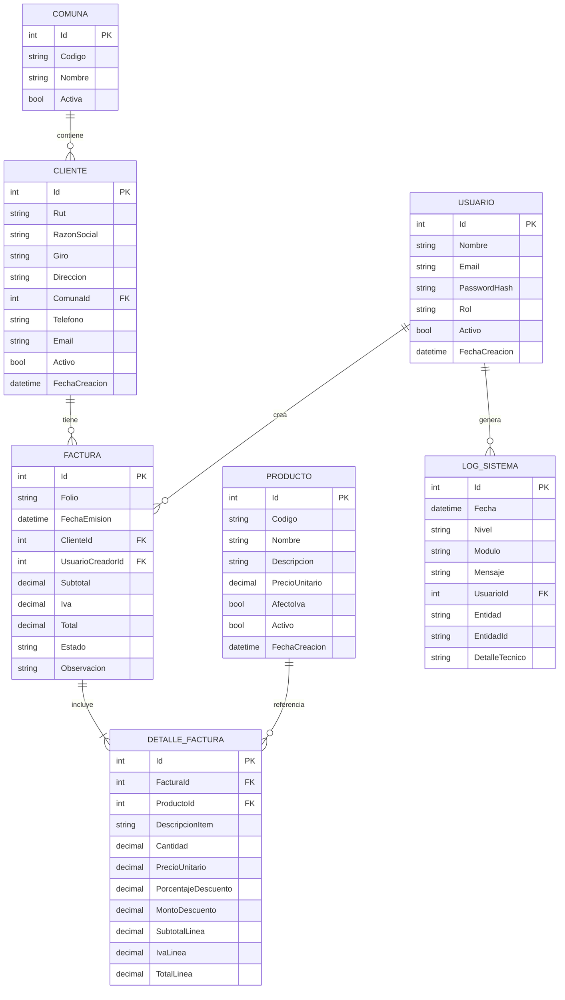

# especificaciones

Necesitamos crear un sistema contable para manejo de facturas.
Para ello, necesito un sistema web (MVC), para mantener los datos de usuarios, clientes, facturas, comunas, productos, logs, etc.

## capitulo 1: alcance funcional

El sistema debe permitir administrar informacion maestra y operativa para el proceso de facturacion:

* usuarios
* clientes
* facturas (encabezado y detalle)
* productos
* comunas
* logs del sistema

## capitulo 2: modelos de dominio

Definir modelos (entidades) para representar el dominio contable y sus relaciones:

* Usuario
* Cliente
* Factura
* DetalleFactura
* Producto
* Comuna
* LogSistema

Cada modelo debe incluir:

* identificador primario
* campos obligatorios
* reglas basicas de validacion
* relaciones (por ejemplo, Cliente -> Facturas)

### detalle de campos por modelo

**Usuario**

* Id (int)
* Nombre (string, requerido)
* Email (string, requerido, unico)
* PasswordHash (string, requerido)
* Rol (string, requerido: Administrador/Operador)
* Activo (bool)
* FechaCreacion (datetime)

**Cliente**

* Id (int)
* Rut (string, requerido, unico)
* RazonSocial (string, requerido)
* Giro (string)
* Direccion (string, requerido)
* ComunaId (int, requerido)
* Telefono (string)
* Email (string)
* Activo (bool)
* FechaCreacion (datetime)

**Comuna**

* Id (int)
* Codigo (string, requerido, unico)
* Nombre (string, requerido)
* Activa (bool)

**Producto**

* Id (int)
* Codigo (string, requerido, unico)
* Nombre (string, requerido)
* Descripcion (string)
* PrecioUnitario (decimal, requerido)
* AfectoIva (bool)
* Activo (bool)
* FechaCreacion (datetime)

**Factura**

* Id (int)
* Folio (string, requerido, unico)
* FechaEmision (datetime, requerido)
* ClienteId (int, requerido)
* Subtotal (decimal, requerido)
* Iva (decimal, requerido)
* Total (decimal, requerido)
* Estado (string, requerido: Borrador/Emitida/Anulada)
* Observacion (string)
* UsuarioCreadorId (int, requerido)

**DetalleFactura**

* Id (int)
* FacturaId (int, requerido)
* ProductoId (int, requerido)
* DescripcionItem (string, requerido)
* Cantidad (decimal, requerido)
* PrecioUnitario (decimal, requerido)
* PorcentajeDescuento (decimal)
* MontoDescuento (decimal)
* SubtotalLinea (decimal, requerido)
* IvaLinea (decimal, requerido)
* TotalLinea (decimal, requerido)

**LogSistema**

* Id (int)
* Fecha (datetime, requerido)
* Nivel (string, requerido: Info/Warning/Error)
* Modulo (string, requerido)
* Mensaje (string, requerido)
* UsuarioId (int, nullable)
* Entidad (string)
* EntidadId (string)
* DetalleTecnico (string)

### diagrama mermaid (modelo de datos)

## capitulo 3: capa de servicios

Implementar servicios para encapsular logica de negocio:

* servicio de clientes
* servicio de productos
* servicio de facturas (calculos, subtotal, impuestos, total)
* servicio de usuarios
* servicio de logs

Responsabilidades esperadas:

* validaciones de negocio
* orquestacion de operaciones
* manejo de errores de negocio

### funciones esperadas por clase de servicio

**ClienteService**

* CrearClienteAsync(clienteDto)
* ActualizarClienteAsync(id, clienteDto)
* EliminarClienteAsync(id)
* ObtenerClientePorIdAsync(id)
* ListarClientesAsync(filtro)
* ValidarRutUnicoAsync(rut, clienteIdExcluir)

**ProductoService**

* CrearProductoAsync(productoDto)
* ActualizarProductoAsync(id, productoDto)
* EliminarProductoAsync(id)
* ObtenerProductoPorIdAsync(id)
* ListarProductosAsync(filtro)
* ValidarCodigoUnicoAsync(codigo, productoIdExcluir)

**FacturaService**

* CrearFacturaAsync(facturaDto)
* AgregarItemAsync(facturaId, itemDto)
* QuitarItemAsync(facturaId, detalleId)
* RecalcularTotalesAsync(facturaId)
* EmitirFacturaAsync(facturaId)
* AnularFacturaAsync(facturaId, motivo)
* ObtenerFacturaPorIdAsync(facturaId)
* ListarFacturasAsync(filtro)

**UsuarioService**

* CrearUsuarioAsync(usuarioDto)
* ActualizarUsuarioAsync(id, usuarioDto)
* DesactivarUsuarioAsync(id)
* ObtenerUsuarioPorIdAsync(id)
* ListarUsuariosAsync(filtro)
* CambiarPasswordAsync(id, passwordActual, passwordNueva)
* ValidarCredencialesAsync(email, password)

**LogService**

* RegistrarInfoAsync(modulo, mensaje, usuarioId)
* RegistrarWarningAsync(modulo, mensaje, usuarioId)
* RegistrarErrorAsync(modulo, mensaje, detalle, usuarioId)
* BuscarLogsAsync(filtro)

### funciones de validacion por servicio

**ClienteService**

* Task<bool> ValidarRutUnicoAsync(string rut, int? clienteIdExcluir = null)
* Task<bool> ValidarComunaExisteAsync(int comunaId)
* Task<ValidationResult> ValidarClienteAsync(ClienteDto cliente)

**ProductoService**

* Task<bool> ValidarCodigoUnicoAsync(string codigo, int? productoIdExcluir = null)
* ValidationResult ValidarPrecio(decimal precioUnitario)
* Task<ValidationResult> ValidarProductoAsync(ProductoDto producto)

**FacturaService**

* Task<bool> ValidarClienteExisteAsync(int clienteId)
* Task<bool> ValidarFolioUnicoAsync(string folio, int? facturaIdExcluir = null)
* Task<ValidationResult> ValidarItemAsync(DetalleFacturaDto item)
* Task<ValidationResult> ValidarTransicionEstadoAsync(string estadoActual, string estadoNuevo)
* ValidationResult ValidarTotales(decimal subtotal, decimal iva, decimal total)

**UsuarioService**

* Task<bool> ValidarEmailUnicoAsync(string email, int? usuarioIdExcluir = null)
* ValidationResult ValidarRol(string rol)
* ValidationResult ValidarPassword(string passwordPlano)
* Task<ValidationResult> ValidarUsuarioAsync(UsuarioDto usuario)

**LogService**

* ValidationResult ValidarNivelLog(string nivel)
* ValidationResult ValidarMensajeLog(string modulo, string mensaje)

## capitulo 4: capa de acceso a datos

Implementar repositorios para acceso a datos sobre Entity Framework y SQLite:

* repositorio generico (opcional)
* repositorios especificos por agregado
* unidad de trabajo (opcional)

Definir consultas principales para:

* listados con filtros
* busquedas por identificador
* creacion, edicion y eliminacion

## capitulo 5: controladores MVC

Crear controladores por modulo funcional:

* UsuariosController
* ClientesController
* FacturasController
* ProductosController
* ComunasController

Cada controlador debe incluir acciones para:

* Index (listar)
* Details (ver)
* Create (crear)
* Edit (editar)
* Delete (eliminar)

## capitulo 6: vistas MVC

Definir vistas Razor para cada controlador con formularios y validaciones:

* vistas de listado
* vistas de mantenimiento (crear/editar)
* vistas de detalle
* mensajes de validacion y error

## capitulo 7: seguridad y perfiles

Definir autenticacion/autorizacion para controlar acceso:

* acceso por usuario autenticado
* perfiles o roles (administrador, operador)
* restricciones por modulo o accion

## capitulo 8: logging y auditoria

Registrar eventos relevantes del sistema:

* inicio de sesion
* creacion/edicion/eliminacion de registros
* errores de aplicacion

Los logs deben permitir trazabilidad basica para soporte.

## capitulo 9: pruebas

Definir pruebas con xUnit para:

* reglas de negocio en servicios
* validaciones principales
* escenarios criticos de facturacion

## capitulo 10: criterios de aceptacion inicial

* CRUD funcional para usuarios, clientes, productos y comunas
* creacion de factura con detalle de productos y calculo de total
* persistencia en SQLite mediante Entity Framework
* registro de eventos principales en logs

