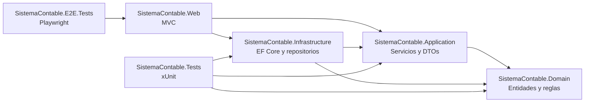

# especificaciones tecnicas

* c# net 10
* Entity Framework
* MVC
* XUnit
* Playwright (pruebas end-to-end)
* base de datos sqlite con conector 

## recomendaciones adicionales

* habilitar nullable reference types y tratar warnings como errores en compilacion
* usar inyeccion de dependencias para servicios y repositorios
* aplicar migraciones de Entity Framework para versionar la base de datos
* definir pruebas unitarias y de integracion para controladores y acceso a datos
* configurar logging estructurado con niveles por entorno (desarrollo/produccion)
* usar appsettings.{Environment}.json para separar configuracion por entorno
* agregar validacion de modelos con DataAnnotations y validaciones de negocio en servicios
* incluir manejo centralizado de errores con middleware/filtros MVC
* ejecutar pruebas end-to-end con Playwright en modo headless dentro de CI

## capitulo: proyectos a crear

Se propone una solucion separada por capas con los siguientes proyectos:

* **SistemaContable.Web** (ASP.NET Core MVC)
  * controladores, vistas, viewmodels, configuracion de pipeline
* **SistemaContable.Application** (Class Library)
  * servicios de aplicacion, dtos, contratos (interfaces), validaciones de negocio
* **SistemaContable.Domain** (Class Library)
  * entidades de dominio, enums, reglas y contratos de dominio
* **SistemaContable.Infrastructure** (Class Library)
  * Entity Framework Core, DbContext, configuraciones, repositorios, migraciones
* **SistemaContable.Tests** (xUnit)
  * pruebas unitarias de servicios y pruebas de integracion principales
* **SistemaContable.E2E.Tests** (Playwright)
  * pruebas end-to-end sobre flujos criticos de interfaz (login, clientes, facturacion)

## diagrama mermaid de proyectos (relacional)

